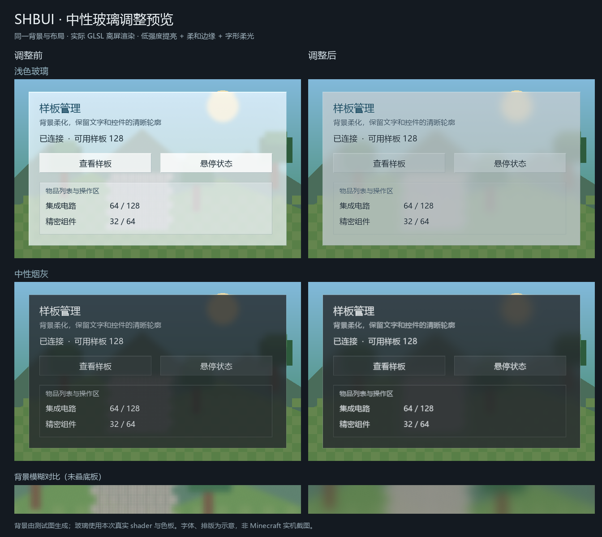

# SH-Better-UI

[简体中文](README.md) · [繁體中文](README.zh-TW.md) · **English**

Maintained by 山海 / dishanhai.

SH-Better-UI is a Minecraft client UI library for Forge 1.20.1 and NeoForge 1.21.1. Both platforms share glass materials, blur, animations, search widgets, and item and fluid pickers. Each platform ships its own standalone mod JAR.

## Requirements

| Platform | Loader | Java | Kotlin runtime |
| --- | --- | --- | --- |
| Minecraft 1.20.1 | Forge 47.4.16 or later | 21 | KotlinForForge 4.12.0, with Kotlin 2.2.21 |
| Minecraft 1.21.1 | NeoForge 21.1.251 for development | 21 | KotlinForForge NeoForge 5.10.0 or a compatible 5.x release |

Install KotlinForForge separately. JEI is optional. Forge integrations under `compat.ldlib` use LDLib `1.0.33.b`. NeoForge integrations under `compat.ldlib2` use LDLib2 `2.2.44`. Both native Screen builds can use the shared dialog, anchored bubble, action sheet, and pull-to-refresh APIs. See the [integration examples](SCREEN_INTERACTIONS.md).

## Build and install

For Forge development, place `kotlinforforge-4.12.0-all.jar` and `ldlib-forge-1.20.1-1.0.33.b.jar` in `libs/`. Use JDK 21 for both builds.

- Run `build-local.ps1` to build Forge with Gradle 8.8, including JUnit and reobfuscation.
- Run `簡易構建.bat` to build Forge and NeoForge in sequence. It clears each platform's `build/libs` and lists the resulting JARs. Pass `--no-pause` in automation to return the build exit code without waiting for input. Keep the script in UTF-8 without BOM with Windows CRLF line endings.
- If the JEI compile-time API is missing from the Gradle cache, run the build without `--offline` first.

To build NeoForge directly with its Gradle 9.2.1 wrapper and ModDevGradle 2.0.148, run the following from the repository root.

```powershell
$env:JAVA_HOME = 'C:\Program Files\Java\jdk-21.0.11'
$env:TEMP = 'C:\jtmp'
$env:TMP = 'C:\jtmp'
.\neoforge\gradlew.bat -p neoforge test build --no-daemon --console=plain
```

| Use | Artifact |
| --- | --- |
| Forge runtime | `build/libs/sh_better_ui-1.0.3.jar` |
| Forge development | `build/libs/sh_better_ui-1.0.3-dev.jar` |
| NeoForge runtime and development | `neoforge/build/libs/sh_better_ui-neoforge-1.21.1-1.0.3.jar` |

Forge's raw JAR and `build/reobfJar/output.jar` are build intermediates. Install the platform's runtime JAR alongside the consuming mod.

## Integrate with a mod

In Forge, compile against the development JAR. `publishToMavenLocal` publishes `com.dishanhai:sh_better_ui:1.0.3:dev` and sources. You can also reference the local build directly.

```groovy
implementation files('../SH-Better-UI/build/libs/sh_better_ui-1.0.3-dev.jar')
```

Declare the external `sh_better_ui` dependency in `mods.toml`. Use `[1.0.3,2.0.0)` when calling `GlassTheme.SMOKE`. The NeoForge JAR uses Mojang names for both development and runtime. Keep the library classes and shaders in the standalone JAR.

### Glass and Slate themes

Draw the backdrop and panel before foreground text and icons. Register the screens that use glass blur through `GaussBlur.allowScreen(predicate)` during client initialization. The library manages the end-of-frame render hook and refreshes the blur pipeline on resource reload.

```java
var theme = GlassTheme.GLASS;
theme.rootShadow(graphics, x, y, width, height);
theme.backdrop(graphics, x, y, width, height);
theme.box(graphics, x, y, width, height, GlassPalette.ROOT_EDGE, theme.panelBg);
```

- `GlassTheme.SMOKE` uses a 16-GUI-unit background blur with subtle lift and edge lighting. Use `GlassSurface.drawString()` to draw glyphs with a soft outline.
- `GlassSurface.panel()` and `control()` use the neutral light palette. Forge LDLib screens can use `GlassPanelTexture.clearPanel()`, `clearButton()`, and `clearButtonOverlay()`. Use the overlay for controls inside a blurred panel to reuse its backdrop.
- `DarkModeTheme` draws Slate backgrounds, cards, buttons, and inputs. Keep an `Interaction` instance per control and sample its hover, press, focus, enabled, and reduced-motion state. Native widgets handle text input, focus, hit testing, and narration.

### Feedback, input, and accessibility

- `UiButton` provides hover feedback, selection, and narration. Use `setPreview(Component.translatable(...))` for a localized tooltip. `UiAttention` animates tab indicators and content transitions. See the [button and transition guide](docs/attention-feedback.md).
- `PointerDrag` tracks drag and release positions. Recheck the drop target on release and cancel on focus loss. `ScrollPageTurn` handles bounded dragging and wheel-based page changes. `ViewportTransform.zoomAt(...)` keeps the content under the pointer stable. Use the same transform for drawing and hit testing.
- `UiPreferences` passes high contrast, reduced motion, and background blur settings to shared renderers. `UiHistory` stores snapshots for back navigation and undo. `UiConfirmation` handles modal confirmation and returns focus to the parent screen. `UiDisclosure` provides keyboard-operable expansion, and `ButtonFeedback` exposes pending, success, partial, failure, cancellation, and timeout states.
- `InterruptibleAnimation` preserves position and velocity across a reversal. `ClickRipple` and `GlassEffectRenderer` provide optional ripple, flowing border, and glow effects. See the [animation guide](docs/interruptible-animation.md) and [glass effects guide](docs/effects.md).

### Search and JEI

`SearchIndex<T>` indexes localized names, IDs, and aliases. Every search term must match, and terms can match different fields. `SearchField<T>` uses Minecraft's native `EditBox`. Use the arrow keys to select a suggestion, Tab or a click to accept it, Escape to close the list, and Ctrl+Z or Cmd+Z to undo completion.

Forge compiles against JEI `15.49.0.200`. NeoForge compiles against JEI `19.69.0.456`. Use `JeiIntegration.isAvailable()` to check readiness and refresh the ingredient snapshot when `revision()` changes. `recipes(...)` queries visible recipes, and `open(...)` opens JEI's full recipe or uses view.

`JeiSearchPanel` needs at least 144 × 132 GUI pixels. Allow 320 × 200 for a side-by-side layout. Register its `widgets()` on the host screen and use `JeiIntegration.setExtraAreas(this, panel::extraAreas)` to reserve space around it. Draw its background before the widgets and its overlays afterward. Call `tick()` from the screen and give the panel first chance to handle suggestion clicks, scrolling, and Escape. On NeoForge, pass the vertical scroll delta. Use `snapshot()` and `restore(...)` to preserve state on resize. General search also works without JEI.

### Item and fluid picker

`IngredientFilter` matches full IDs, mod IDs, tags, and ingredient kinds. Values within one category are alternatives, and every configured category must match. Empty sets clear their category. Use `SearchIndex` for partial text matches.

```java
var allowed = IngredientFilter.items()
        .withMods(Set.of("minecraft", "gtceu"))
        .withTags(Set.of(ResourceLocation.tryParse("forge:ingots/iron")));
var request = new IngredientPicker.Request(pickerTitle, IngredientCatalog.automatic(),
        allowed, 8, initialSelection, uiPreferences);
IngredientPicker.open(this, request, () -> rebuiltPickerButton, this::applySelection);
```

The tag ID in this example uses Forge naming. Supply IDs from the target platform's registry. `IngredientCatalog` supports JEI, the vanilla registry, and fixed caller-provided candidates. `automatic()` prefers JEI and falls back to the registry while JEI is unavailable. The picker supports single and multiple selection, a selected-only view, undo, cancel, and confirmation. Confirmation returns an immutable list. The draft and filters survive resizing and a visit to a JEI recipe.

Use `IngredientValues.item(stack)` and `fluid(stack)` to create candidates from platform stacks. `Ingredient.copy(...)` returns a native stack copy with its amount and NBT or data components. Use `Ingredient.key()` for identity within the running session and persist the native stack data. Embedded panels can use `setCatalog`, `setFilter`, `setChosen`, and `refreshSelection()` to work with a host-managed draft.

### Text and layout alignment

`UiText.drawLeft`, `drawCentered`, and `drawRight` use the native font to align a single `Component` horizontally and center it vertically within the supplied area. `UiLayout.align` places one element. `row` and `column` arrange elements with a configurable gap, group alignment, and per-element cross-axis alignment. Use the returned `Bounds` for drawing and hit testing. Elements keep their requested size when they exceed the available space. Both loaders share the API. [Java example](README.md#文字与布局对齐)

## Preview and verification

The comparison shows the earlier glass on the left and the updated glass on the right. The glass uses the actual shader and palette in an off-screen render. The layout is a test fixture.



See the [neutral glass maintenance notes](docs/neutral-glass-maintenance.md), [NeoForge verification notes](neoforge/VERIFICATION.md), and [in-game checklist](TODO.md).
