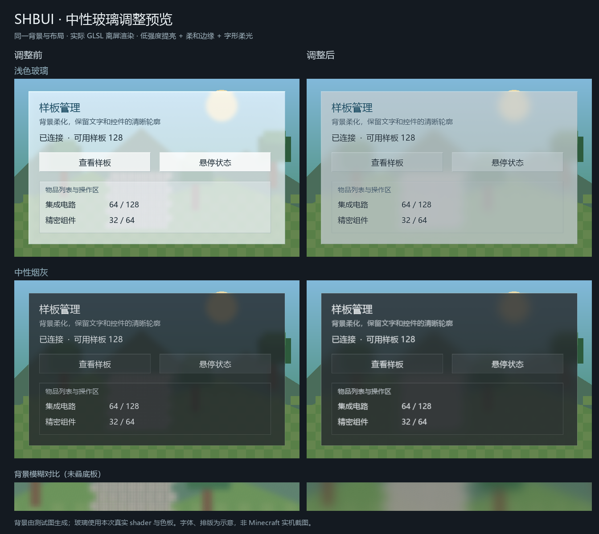

# SH-Better-UI

作者：山海／dishanhai。

Forge 1.20.1 的共用玻璃 UI 庫，提供深色與中性淺色材質、局部高斯／方向模糊、彈簧動畫及可選 LDLib 材質接口。以獨立模組 jar 發行，消費模組不內嵌 UI 庫，更新時直接替換 UI 庫 jar。

## 環境與依賴

- Minecraft 1.20.1、Forge 47.4.16 或更高、Java 21。
- 必需 KotlinForForge 4.12.0（2.2.21 runtime），由整合包單獨提供；本庫不內嵌任何 jar。
- 使用 LDLib 接口時另裝 `ldlib-forge-1.20.1-1.0.33.b.jar`；原生 Screen 使用者無須安裝 LDLib。
- 開發時將 `kotlinforforge-4.12.0-all.jar` 及 `ldlib-forge-1.20.1-1.0.33.b.jar` 放入 `libs/`。

## 建置

執行 `build-local.ps1` 或 `簡易構建.bat`，均使用本地 Gradle 8.8／JDK 21，包含 JUnit 與 reobfJar。

`簡易構建.bat` 使用 UTF-8 無 BOM／Windows CRLF 換行，請保留此格式。雙擊執行後會保留結果視窗；自動化呼叫可傳入 `--no-pause`，退出碼沿用建置結果。

```powershell
.\gradle-install\gradle-8.8\bin\gradle.bat build --offline --no-daemon --console=plain
```

正式包為 `build/libs/sh_better_ui-1.0.3.jar`，原始重映射結果為 `build/reobfJar/output.jar`。開發包為 `build/libs/sh_better_ui-1.0.3-dev.jar`，只能用於編譯與開發環境。`raw` 包是建置中間產物，不能放入遊戲。

## 消費端接入

編譯時使用 dev 包，發行時同時安裝獨立正式 UI 庫。可透過 `publishToMavenLocal` 發布 `com.dishanhai:sh_better_ui:1.0.2:dev` 及 sources，或使用本地檔案依賴：

```groovy
implementation files('../SH-Better-UI/build/libs/sh_better_ui-1.0.3-dev.jar')
```

消費端 `mods.toml` 宣告 `sh_better_ui` 版本範圍 `[1.0.2,2.0.0)`，不得再打入同一份 UI 類別或 shader。`1.0.1` 提供星律煙灰材質及雙樣式 tooltip API；原 `1.0.0` 不具備這些入口。`1.0.2` 將煙灰面板調為中等模糊（12 GUI 單位半徑），保留其他樣式。消費端在客戶端初始化時以 `GaussBlur.allowScreen(predicate)` 註冊允許的畫面；庫負責唯一的幀末事件與資源生命週期。

`gt_shanhai:ultimate_terminal` 的設定與報告畫面、`gt_shanhai:pattern_generator` 的生成畫面使用本庫的玻璃材質、模糊、彈簧與按鈕回饋。換頁時間軸由 `PageTransition` 提供；生成預覽的錯峰入場及捲動模糊強度由 `GuiMotion` 提供。畫面的欄位、物品資料與操作流程仍由 `gt_shanhai` 處理。

資源重載會在渲染執行緒釋放舊管線；若目前仍開著已註冊的玻璃畫面，立即以新資源預熱管線，無須關閉重開。登出則只釋放資源。遊戲驗收應包含保持畫面開啟時 F3+T，確認模糊恢復且文字／圖示仍清晰。

`1.0.3` 新增 `GlassTheme.SMOKE`，共用星律的 `GlassColors.SMOKE`。本次材質維護改用 16 GUI 單位的密採樣背景模糊，保留微量提亮與邊緣柔光。消費端使用此主題時，最低依賴版本須為 `[1.0.3,2.0.0)`。商店可並存經典、深藍動態玻璃與中性煙灰；選擇器跟隨所選主題，煙灰內層控件不重複模糊。

通用接口位於 `com.dishanhai.sh_better_ui.client.glass`、`client.blur` 與 `client.gui.scaled`。在面板內容之前繪製玻璃底，再畫文字與圖示：

```java
var theme = GlassTheme.GLASS;
theme.rootShadow(graphics, x, y, width, height);
theme.backdrop(graphics, x, y, width, height);
theme.box(graphics, x, y, width, height, GlassPalette.ROOT_EDGE, theme.panelBg);
```

`compat.ldlib.GlassPanelTexture` 提供 `root()`、`panel()`、`display()`、`page()` 與 `button()` 材質工廠。只有 LDLib 消費端引用此套件；每個按鈕各自建立 `button()`，讓 hover 彈簧保持獨立。

### 中性淺色玻璃

參考 `src_collection/collection/liquid-glass-react-master` 的背景模糊、邊緣折射與受光亮邊思路，沿用本庫既有 shader 實作。淺色版改為柔和淺灰，`GlassStyle.CLEAR` 的提亮由 0.035 降至 0.008，保留較弱的受光亮邊與折射；面板／獨立按鈕模糊半徑為 14／8 GUI 單位。淺灰與煙灰底使用 65 點高斯核，舊有飛行及切頁模糊保留原核。`GlassSurface.panel()` 與 `control()` 共用 `GlassColors.CLEAR`，面板內按鈕只薄疊色；獨立按鈕保留深色文字所需的底色。shader 不可用時仍有淺灰半透明底。

```java
GlassSurface.panel(graphics, x, y, width, height);
GlassSurface.drawString(graphics, font, title, x + 8, y + 8, GlassColors.CLEAR.TEXT);
```

LDLib 可用 `GlassPanelTexture.clearPanel()` 與 `clearButton()`；按鈕已位於毛玻璃面板內時用 `clearButtonOverlay()`，避免每個按鈕重複執行背景模糊。`GlassColors.select(clear)` 提供相應文字、卡片與控制項顏色。原有深色入口與色板保持不變。

`GlassSurface.drawString()` 復用原版字形描邊，以低透明度白色柔光托住字形，主文字保持清晰；可傳入 `String` 或已排版的 `FormattedCharSequence`。煙灰主題的 `GlassTheme.drawCentered()` 已使用此入口。消費端自行調用原版 `graphics.drawString()` 的文字需改用上述接口才會有字形柔光；底板材質不會攔截其他模組的文字渲染。

主模組設定頁新增「終極終端與樣板生成工具使用淺色玻璃」選項，寫入本機 `config/gt_shanhai/ui-client.toml`，預設關閉，重新開啟相關畫面後生效；終極終端的設定與報告畫面共用此選項。

庫不包含交易、機器、配方、AE 或 GTCEu 邏輯。遊戲內外觀、第三方 shader 相容及多種 GUI scale 仍須實機驗收。

### 可打斷動畫

`client.gui.scaled.InterruptibleAnimation` 復用 `Spring`，提供保留位置與速度的開關、反向及換目標，並支援延遲換目標、停止、立即完成與減少動效模式。Forge／NeoForge 共用同一接口；每個控件獨立持有實例，事件與繪製使用相同的單調毫秒時鐘。本次亦修正 Spring 延遲換目標時凍結舊軌跡的問題。完整接入及生命週期示例見[可打斷動畫](docs/interruptible-animation.md)。

```java
// 控件字段；相关类型均位于 client.gui.scaled。
private final InterruptibleAnimation motion = new InterruptibleAnimation(Spring.PANEL);
// 开关事件：motion.setOpen(open, PageTransition.nowMs());
// 每帧绘制：float progress = motion.sample(PageTransition.nowMs(), reducedMotion);
// 关闭途中再次 setOpen(true, ...) 会从当时的位置与速度继续。
```

### 可選按鈕與玻璃動效

`client.gui.scaled` 提供三項可組合的裝飾接口，消費端調用後才顯示：

- `ClickRipple` + `GlassEffectRenderer.drawRipple`：每個按鈕獨立持有點擊漣漪，420ms 擴散淡出；連點會重啟，原點隨控件重排。
- `GlassEffectRenderer.drawFlowBorder`：沿矩形四邊循環的細流光，2 秒一輪。
- `GlassEffectRenderer.drawBreathingGlow`：控件外側 3 GUI 像素柔光，2.4 秒一輪，強度可直接使用已有 hover 彈簧。

點擊回調確認操作被接受後，調用 `ripple.trigger(mouseX, mouseY, x, y, w, h, nowMs)`；每幀先畫底板，再畫裝飾，最後畫文字與圖示：

```java
GlassEffectRenderer.drawBreathingGlow(g, x, y, w, h, hover, nowMs, reducedMotion, accent);
GlassEffectRenderer.drawFlowBorder(g, x, y, w, h, nowMs, reducedMotion, accent);
GlassEffectRenderer.drawRipple(g, x, y, w, h, ripple, nowMs, reducedMotion, accent);
```

`ripple` 為控件自己的 `new ClickRipple()`，`accent` 使用當前主題色；點擊與繪製使用相同毫秒時鐘。關閉／移除時調用 `ripple.clear()`。裝飾與底板放在同一個 `withButtonMotion` 回調中，沿用原控件的命中區、點擊行為及裁切。

`reducedMotion=true` 時，漣漪改成均勻淡出，流光與呼吸改成靜態亮度。這些接口只提交原生 GUI 矩形，不新增後處理、材質或依賴；局部漣漪與 `GaussBlur.requestWave` 的屏幕折射波可分別使用。完整組合與 LDLib 接入示例見[可選玻璃效果](docs/effects.md)。

### 中性玻璃渲染預覽

左為調整前，右為調整後。玻璃使用實際 shader 離屏渲染與實際色板；背景、字體與排版為測試示意，並非 Minecraft 實機畫面。文字柔光的消費端接入範圍及驗證結果見[玻璃維護紀錄](docs/neutral-glass-maintenance.md)，遊戲驗收項目見 [TODO](TODO.md)。



## NeoForge 1.21.1

`neoforge/` 是獨立建置，使用 Java 21、NeoForge 21.1.265、ModDevGradle 2.0.148 與 Gradle 9.2.1。根目錄 Forge 1.20.1 的建置入口與 API 保留。NeoForge 共用玻璃色板、面板、動效與 shader，對入口、客戶端事件、tooltip 與模糊管線使用平台覆寫來源。

```powershell
$env:JAVA_HOME = 'C:\Program Files\Java\jdk-21.0.11'
$env:TEMP = 'C:\jtmp'
$env:TMP = 'C:\jtmp'
.\neoforge\gradlew.bat -p neoforge test build --no-daemon --console=plain
```

正式包為 `neoforge/build/libs/sh_better_ui-neoforge-1.21.1-1.0.3.jar`。NeoForge 使用 Mojang 命名，不需要 Forge 1.20.1 的 devJar／reobfJar 分流；消費專案編譯與遊戲端均依賴此正式 jar。

遊戲端另外安裝 **KotlinForForge NeoForge 5.10.0 或相容的 5.x**，不可使用 Forge 1.20.1 的 4.x。已驗證前置 5.10.0 使用 Kotlin 2.2.20，與本庫 Kotlin compiler 2.2.21 同一條版本線。前置由整合包提供，本庫不內嵌 Kotlin／KFF。`FTB Quest Nexus/neoforge` 直接引用此專案產物提供玻璃 UI。

NeoForge 打包時將 `WaveOrigin` 修正為與 Minecraft `float/count=2` 上傳一致的 GLSL `vec2`，不修改根 Forge 資源；已以實際輸出資源的測試驗證。這項契約修正不等同已完成 GPU／外觀驗收。

NeoForge 版本提供原生 Screen 的公開 API；目前不包含 Forge 1.20.1 專用的 `compat.ldlib.GlassPanelTexture`，不宣告 LDLib 前置。LDLib 消費端應維持使用相應平台版本，不能跨平台混裝。實際測試與待驗項目見 `neoforge/VERIFICATION.md` 與 `TODO.md`。
