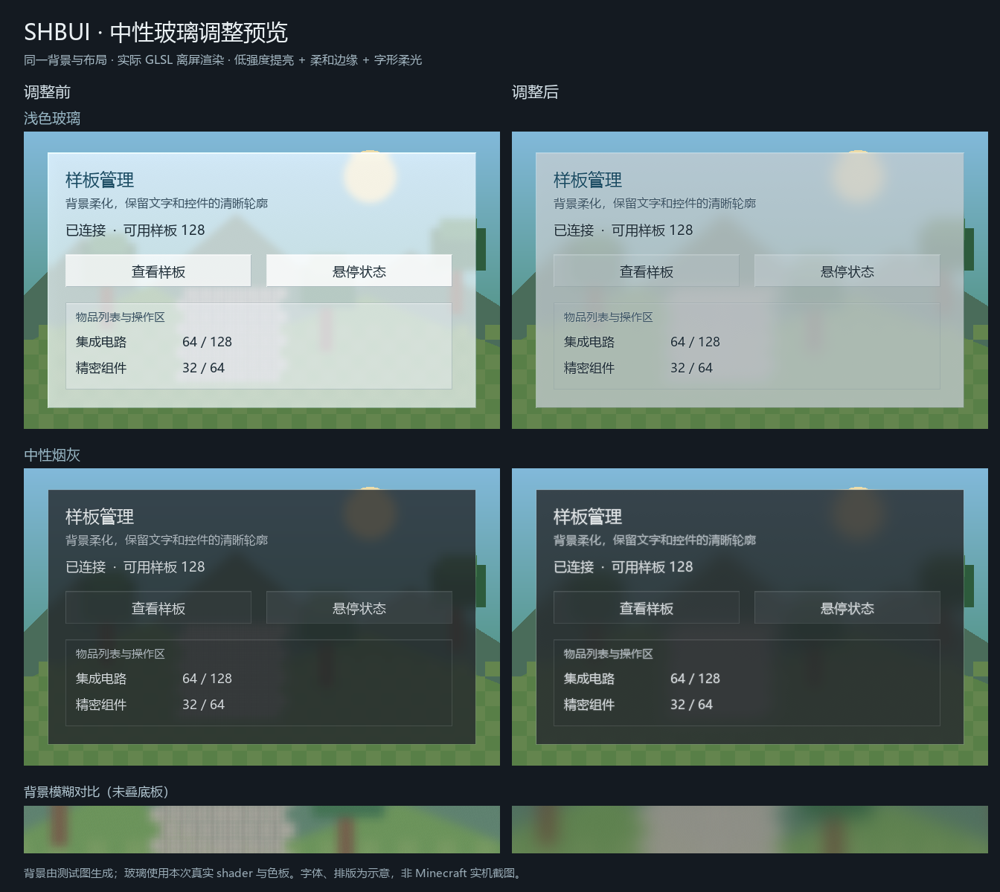

# SH-Better-UI

[简体中文](README.md) · **繁體中文** · [English](README.en.md)

作者：山海／dishanhai。

SH-Better-UI 是 Forge 1.20.1 與 NeoForge 1.21.1 的 Minecraft 客戶端 UI 庫。兩個平台共用玻璃材質、模糊、動畫、搜尋與物品／流體選取元件，並各自提供獨立模組 jar。消費模組以外部依賴接入，更新時替換對應平台的 UI 庫 jar。

## Forge 1.20.1 環境與依賴

- Minecraft 1.20.1、Forge 47.4.16 或更高、Java 21。
- 必需 KotlinForForge 4.12.0（2.2.21 runtime），由整合包單獨提供；本庫不內嵌任何 jar。
- 使用 LDLib 接口時另裝 `ldlib-forge-1.20.1-1.0.33.b.jar`；原生 Screen 使用者無須安裝 LDLib。
- 開發時將 `kotlinforforge-4.12.0-all.jar` 及 `ldlib-forge-1.20.1-1.0.33.b.jar` 放入 `libs/`。

## 建置

使用 `build-local.ps1` 單獨建置 Forge，或執行 `簡易構建.bat` 依序建置 Forge 與 NeoForge。兩個入口均使用 JDK 21。Forge 使用 Gradle 8.8，建置包含 JUnit 與 reobfJar。批次腳本會清理兩個平台各自的 `build/libs`，並列出新產物。

首次建置時先移除命令中的 `--offline`，讓 Gradle 下載 JEI 編譯用 API。快取建立後可恢復離線建置。

`簡易構建.bat` 使用 UTF-8 無 BOM／Windows CRLF 換行，請保留此格式。雙擊執行後會保留結果視窗；自動化呼叫可傳入 `--no-pause`，退出碼沿用建置結果。

```powershell
.\gradle-install\gradle-8.8\bin\gradle.bat build --offline --no-daemon --console=plain
```

正式包為 `build/libs/sh_better_ui-1.0.3.jar`，原始重映射結果為 `build/reobfJar/output.jar`。開發包為 `build/libs/sh_better_ui-1.0.3-dev.jar`，只能用於編譯與開發環境。`raw` 包是建置中間產物，不能放入遊戲。

## 消費端接入

編譯時使用 dev 包，發行時同時安裝獨立正式 UI 庫。可透過 `publishToMavenLocal` 發布 `com.dishanhai:sh_better_ui:1.0.3:dev` 及 sources，或使用本地檔案依賴：

```groovy
implementation files('../SH-Better-UI/build/libs/sh_better_ui-1.0.3-dev.jar')
```

消費端 `mods.toml` 宣告 `sh_better_ui` 版本範圍 `[1.0.2,2.0.0)`，不得再打入同一份 UI 類別或 shader。`1.0.1` 提供星律煙灰材質及雙樣式 tooltip API；原 `1.0.0` 不具備這些入口。`1.0.2` 將煙灰面板調為中等模糊（12 GUI 單位半徑），保留其他樣式。消費端在客戶端初始化時以 `GaussBlur.allowScreen(predicate)` 註冊允許的畫面；庫負責唯一的幀末事件與資源生命週期。

`gt_shanhai:ultimate_terminal` 的設定與報告畫面、`gt_shanhai:pattern_generator` 的生成畫面使用本庫的玻璃材質、模糊、彈簧與按鈕回饋。換頁時間軸由 `PageTransition` 提供；生成預覽的錯峰入場及捲動模糊強度由 `GuiMotion` 提供。畫面的欄位、物品資料與操作流程仍由 `gt_shanhai` 處理。

資源重載會在渲染執行緒釋放舊管線；若目前仍開著已註冊的玻璃畫面，立即以新資源預熱管線，無須關閉重開。登出則只釋放資源。遊戲驗收應包含保持畫面開啟時 F3+T，確認模糊恢復且文字／圖示仍清晰。

`1.0.3` 新增 `GlassTheme.SMOKE`，共用星律的 `GlassColors.SMOKE`。本次材質維護改用 16 GUI 單位的密採樣背景模糊，保留微量提亮與邊緣柔光。消費端使用此主題時，最低依賴版本須為 `[1.0.3,2.0.0)`。商店可並存經典、深藍動態玻璃與中性煙灰；選擇器跟隨所選主題，煙灰內層控件不重複模糊。

通用接口位於 `com.dishanhai.sh_better_ui.client.glass`、`client.blur` 與 `client.gui.scaled`。在面板內容之前繪製玻璃底，再畫文字與圖示：

```java
var theme = GlassTheme.GLASS;
theme.rootShadow(graphics, x, y, width, height);
theme.backdrop(graphics, x, y, width, height);
theme.box(graphics, x, y, width, height, GlassPalette.ROOT_EDGE, theme.panelBg);
```

`compat.ldlib.GlassPanelTexture` 提供 `root()`、`panel()`、`display()`、`page()` 與 `button()` 材質工廠。只有 LDLib 消費端引用此套件；每個按鈕各自建立 `button()`，讓 hover 彈簧保持獨立。

### 中性淺色玻璃

參考 `src_collection/collection/liquid-glass-react-master` 的背景模糊、邊緣折射與受光亮邊思路，沿用本庫既有 shader 實作。淺色版改為柔和淺灰，`GlassStyle.CLEAR` 的提亮由 0.035 降至 0.008，保留較弱的受光亮邊與折射；面板／獨立按鈕模糊半徑為 14／8 GUI 單位。淺灰與煙灰底使用 65 點高斯核，舊有飛行及切頁模糊保留原核。`GlassSurface.panel()` 與 `control()` 共用 `GlassColors.CLEAR`，面板內按鈕只薄疊色；獨立按鈕保留深色文字所需的底色。shader 不可用時仍有淺灰半透明底。

```java
GlassSurface.panel(graphics, x, y, width, height);
GlassSurface.drawString(graphics, font, title, x + 8, y + 8, GlassColors.CLEAR.TEXT);
```

LDLib 可用 `GlassPanelTexture.clearPanel()` 與 `clearButton()`；按鈕已位於毛玻璃面板內時用 `clearButtonOverlay()`，避免每個按鈕重複執行背景模糊。`GlassColors.select(clear)` 提供相應文字、卡片與控制項顏色。原有深色入口與色板保持不變。

`GlassSurface.drawString()` 復用原版字形描邊，以低透明度白色柔光托住字形，主文字保持清晰；可傳入 `String` 或已排版的 `FormattedCharSequence`。煙灰主題的 `GlassTheme.drawCentered()` 已使用此入口。消費端自行調用原版 `graphics.drawString()` 的文字需改用上述接口才會有字形柔光；底板材質不會攔截其他模組的文字渲染。

主模組設定頁新增「終極終端與樣板生成工具使用淺色玻璃」選項，寫入本機 `config/gt_shanhai/ui-client.toml`，預設關閉，重新開啟相關畫面後生效；終極終端的設定與報告畫面共用此選項。

庫不包含交易、機器、配方、AE 或 GTCEu 邏輯。遊戲內外觀、第三方 shader 相容及多種 GUI scale 仍須實機驗收。

### Slate 暗黑模式

`client.gui.scaled.DarkModeTheme` 提供 Forge／NeoForge 共用的原生繪製接口。`background()` 畫不透明的 Slate 900 底色，`card()`、`button()`、`input()` 分別畫圓角卡片、按鈕與輸入框。以 `State.titleText()`、`secondaryText()`、`controlText()` 取得文字色，提示文字可用 `TEXT_MUTED`。主要操作與焦點用藍色，成功狀態可搭配 `SUCCESS` 與文字或圖示。

每個控件保留一個 `Interaction.card()` 或 `Interaction.control()`，每幀傳入實際懸停、按住、焦點與啟用狀態。以按鈕為例：

```java
private final DarkModeTheme.Interaction motion = DarkModeTheme.Interaction.control();

// 由原生控件提供狀態，message 為已翻譯的 Component。
var state = motion.sample(hovered, pressed, focused, enabled, reducedMotion, PageTransition.nowMs());
DarkModeTheme.button(graphics, x, y, width, height, state, true, () -> {
    int textX = x + (width - font.width(message)) / 2;
    int textY = y + (height - font.lineHeight) / 2;
    graphics.drawString(font, message, textX, textY, state.controlText(), false);
});
```

卡片懸停時抬升 2 個 GUI 單位，文字過渡 200 毫秒，卡片底板過渡 300 毫秒。按鈕在按下的第一幀即縮至 98%，放開後以 200 毫秒復位，取消時用 `motion.cancelPress(nowMs)` 即時清除回饋。焦點環為 2 單位藍邊加 2 單位深色間隔。控件周圍預留至少 4 個 GUI 單位，卡片上方預留 6 個，避免裁切焦點環。輸入框先畫主題底板，再由原生控件畫文字、游標與選取區。畫面負責原生焦點、鍵盤導航、旁白及命中區。傳入 `reducedMotion=true` 時，顏色與內凹回饋即時更新，省去抬升與縮放。

### 按鈕與畫面切換提示

公開的 `UiButton` 提供懸停高亮、原生功能提示及 `setSelected` 選中標記。用 `setPreview(Component.translatable(...))` 指定功能說明，預設提示顯示完整按鈕名稱。`UiAttention` 讓頁籤指示條連續移動，並提供新內容的短距淡入與目標亮邊。減少動效時立即顯示目標，保留選中標記。庫內展開控件與 JEI 面板已接入。其他消費畫面的接入、座標換算與驗證範圍見 [切換回饋說明](docs/attention-feedback.md)。

### 直接拖曳、滑動與縮放

- 每個拖曳區持有一個 `PointerDrag`。用 `DarkModeTheme.dragHandle()` 畫把手，以同一矩形命中。若把手畫在會抬升的卡片內，命中也要計入 `state.cardOffset()`。在子控件未消耗事件時呼叫 `begin(button, mouseX, mouseY)`，用 `active()` 顯示按住狀態，再將 `offsetX()/offsetY()` 加到物件原座標，讓預覽跟隨指標。拖動期間可用 `DarkModeTheme.dropTarget()` 標記經畫面驗證的落點。`release()` 會納入放開位置，畫面在提交前應重新驗證。失焦、關閉或取消時呼叫 `cancel()`。
- 列表拖動時，將 `move()` 回傳的 `Delta.y()` 交給 `ScrollPageTurn.dragOffset(scrollOffset, delta.y(), maxScroll)`，並立即套用新偏移。放開時也套用 `release()` 回傳的最後一段位移。超出邊界的位移會被截去，反向時列表立即跟手；需要捲動換頁的區域仍可使用下面的滾輪入口。
- `ViewportTransform.zoomAt(anchorX, anchorY, factor, minScale, maxScale)` 接收滾輪或平台手勢提供的相對比例，維持錨點下的內容位置。將同一個結果交給 `GuiRenderUtil.applyViewport()` 繪製，並用 `contentX()/contentY()` 將指標換回內容座標做命中測試。畫面保留既有裁切與鍵盤操作，並負責接收裝置手勢。

### 使用者掌控與無障礙

`UiPreferences` 將高對比、減少動效與背景模糊設定交給共用繪製入口。由消費畫面讀取可用的設定並傳入 `DarkModeTheme.Interaction`、`ButtonFeedback.visual()`、`PageTransition.advance()` 或 `InterruptibleAnimation.sample()`。高對比使用清楚的邊界與不透明底板，減少動效時保留可辨識的狀態。文字排版沿用原生字體，畫面在 GUI 比例變更時重算版面。

- `UiHistory<S>` 可保存返回和本地撤銷需要的獨立快照。返回與撤銷各用一個實例。切入子頁前保存搜尋、篩選和捲動位置；提交可逆編輯前保存編輯狀態。由畫面套用 `restore()` 取出的快照。伺服器資料的撤銷則由業務回執確認。
- `UiConfirmation.open()` 在當前畫面上開啟原生模態確認。`Prompt` 由畫面傳入本地化標題、操作對象與後果，以及確認和取消按鈕名稱。確認回調只執行一次；取消與 Escape 回到父畫面，並用提供的焦點查詢找到重建後的控件。可提供僅繪圖的背景回調保留原畫面脈絡，傳 `null` 時使用純色底。長內容支援滾輪及 Page Up／Page Down。
- `UiDisclosure` 提供有原生鍵盤操作與旁白的展開按鈕。畫面重排時可重建按鈕，保留 `UiDisclosure` 與草稿，回調只切換可見性與版面。
- `ButtonFeedback.status()` 提供等待、成功、部分完成、失敗、取消及逾時等狀態。可透過 `Component.translatable(status.translationKey())` 顯示本地化文字，或在狀態變更時通知旁白。收到取消回執後再呼叫 `resolveCancelled()`。

### 搜尋、預測與自動填充

`client.gui.search.SearchIndex<T>` 和 `SearchField<T>` 由 Forge 1.20.1／NeoForge 1.21.1 共用。索引以已本地化的純文字名稱、任意數量的 ID 和別名建立快照。多詞查詢要求每個詞都命中，詞可落在不同欄位。比對忽略大小寫與多餘空白。

索引會為名稱和別名中的連續漢字產生拼音。輸入 `tieding`、`tie ding` 或 `td` 都可以找到「鐵錠」和「铁锭」，也可和漢字或 ID 一起搜尋。字面名稱和 ID 優先出現在聯想中，選中拼音候選時填入原名稱。多音字採用預設讀音，呼叫端可以用別名補充其他讀音。

- `search(query, scope)` 按來源順序回傳命中項目，空查詢回傳範圍內全部項目。`suggest(query, scope, limit)` 依名稱、ID 的精確／前綴／包含命中排序，最後列出別名或跨欄位命中。自繪輸入框可用 `Suggestion.suffixFor(query)` 取得可直接追加的灰字後綴。
- `SearchField` 沿用原生 `EditBox`。輸入變更會更新聯想，游標在末端且沒有選取文字時才顯示灰字。上下鍵選擇，`Tab` 或點擊填充，`Esc` 收起聯想並保留輸入。`setOnSubmit` 接收 `Enter` 提交的當前查詢，`Ctrl+Z`（Mac 為 `⌘Z`）或 `undoCompletion()` 恢復填充前的查詢。
- `setResponder` 在查詢實際變更時通知一次。分類切換時以 `setScope` 重新提供範圍，資料或語言變更時以 `setIndex` 替換索引；兩者都保留輸入文字。

原生 `Screen` 接入範例，`refreshResults` 和 `submitSearch` 為畫面自己的方法。

```java
// import com.dishanhai.sh_better_ui.client.gui.search.SearchField;
// import com.dishanhai.sh_better_ui.client.gui.search.SearchIndex;
private SearchField<String> search;

// 在 init() 建立；名稱來自遊戲本地化。
var entries = List.of(new SearchIndex.Entry<>("iron",
        Component.translatable("item.minecraft.iron_ingot").getString(),
        List.of("minecraft:iron_ingot"), List.of("tieding", "td")));
var index = new SearchIndex<>(entries);
search = addRenderableWidget(new SearchField<>(font, 16, 16, 168, 20, index));
search.setResponder(query -> refreshResults(index.search(query)));
search.setOnSubmit(this::submitSearch);

// 在 render() 的普通控件繪製完成後。
search.renderSuggestions(graphics, mouseX, mouseY, height);

// 在 mouseClicked() 的普通分派前。
if (search.mouseClickedSuggestion(mouseX, mouseY, button, height)) return true;

// 在 mouseScrolled() 的普通分派前；NeoForge 請傳入垂直滾動量。
if (search.mouseScrolledSuggestions(mouseX, mouseY, verticalDelta, height)) return true;

// 在 keyPressed() 的 super 呼叫前。Screen 預設會先處理 Esc 關閉。
if (keyCode == GLFW.GLFW_KEY_ESCAPE && search.dismissSuggestions()) return true;
```

搜尋框與聯想清單使用同一套 GUI 座標。重建畫面時可先保存 `getValue()`，再用 `setValue()` 還原，並以同一個範圍條件更新結果和聯想。

### JEI 接入與配方預覽

JEI 為可選前置。Forge 1.20.1 以 JEI `15.49.0.200` 編譯，NeoForge 1.21.1 以 JEI `19.69.0.456` 編譯。兩版各自發布，消費模組可以只依賴 SH-Better-UI 的公開接口。未安裝 JEI 時，共用搜尋仍可使用。

- `client.jei.JeiIntegration` 提供素材快照、圖示與提示、配方查詢及開啟 JEI 的接口。使用 `isAvailable()` 判斷 JEI 是否已載入當前世界的資料，`revision()` 變更時重新取得 `ingredients()`。使用 `Ingredient.key()` 區分同一註冊 ID 的變體。`recipes(ingredient, direction, limit)` 查詢可見配方，`open(ingredient, direction)` 開啟 JEI 的完整取得方式或用途。
- `client.gui.search.JeiSearchPanel` 提供可嵌入原生 `Screen` 的搜尋與唯讀預覽。用名稱、ID、別名及模組篩選找物品／流體，選中結果後查看原生提示或配方。在配方區切換「取得方式」和「用途」，也可開啟完整 JEI 頁面。若呼叫端設定 `setOnChoose`，玩家可用「選用」把素材交回呼叫端。

嵌入方式如下。面板需要 `144 × 132` GUI 像素，建議預留 `320 × 200` 以上讓結果和配方並排。`panel` 由畫面持有，畫面調整尺寸時可保存 `snapshot()`，重建後用 `restore(snapshot)` 還原搜尋和選取。

```java
// 在 Screen.init()，panelLeft、panelTop、panelWidth、panelHeight 由畫面排版決定。
panel = new JeiSearchPanel(font, panelLeft, panelTop, panelWidth, panelHeight);
for (var widget : panel.widgets()) addRenderableWidget(widget);
JeiIntegration.setExtraAreas(this, panel::extraAreas);

// 在 Screen.render()，先畫面板，再由 Screen 繪製原生控件，最後畫覆層。
panel.renderBackground(graphics);
super.render(graphics, mouseX, mouseY, partialTick);
panel.renderOverlays(graphics, mouseX, mouseY, height);

// 在 Screen.tick()。
panel.tick();

// 在 Screen.mouseClicked() 和 mouseScrolled() 的普通分派前。
if (panel.mouseClicked(mouseX, mouseY, button, height)) return true;
if (panel.mouseScrolled(mouseX, mouseY, verticalDelta, height)) return true;

// 在 Screen.keyPressed() 的 super 呼叫前。
if (keyCode == GLFW.GLFW_KEY_ESCAPE && panel.dismissSuggestions()) return true;
```

`setExtraAreas` 讓 JEI 側欄避開當前畫面的面板和聯想清單。畫面提供者應使用 `panel::extraAreas`，面板永久移除時可傳入 `null` 撤銷。NeoForge 的 `mouseScrolled` 需傳入垂直滾動量。

### 物品與流體篩選、選取

`client.gui.filter.IngredientFilter` 是 JEI 與自建素材庫共用的不可變 `Predicate<Ingredient>`。`withKinds`、`withIds`、`withMods`、`withTags` 採完整值比對，同類任一符合，跨類全部符合，空集合解除該類限制。自訂條件使用 `and`、`or`、`negate`。名稱、ID 片段與別名仍沿用 `SearchIndex`，`JeiSearchPanel.setFilter` 同步限制搜尋結果和聯想。

```java
var allowed = IngredientFilter.items()
        .withMods(Set.of("minecraft", "gtceu"))
        .withTags(Set.of(ResourceLocation.tryParse("forge:ingots/iron")));

var request = new IngredientPicker.Request(pickerTitle, IngredientCatalog.automatic(),
        allowed, 8, initialSelection, uiPreferences);
IngredientPicker.open(this, request, () -> rebuiltPickerButton, selected -> {
    // 回到父畫面後提交草稿；空清單可用來清除篩選。
    applySelection(selected);
});
```

`IngredientPicker`、`IngredientCatalog`、`IngredientValues` 和 `IngredientSelection` 位於 `client.gui.selection`。`Request.single` 和 `Request.multiple` 提供預設值，完整建構子可設定業務條件、初始候選和 `UiPreferences`。選取器可依種類、名稱／ID、模組及標籤縮小結果。玩家可切換已選檢視、撤銷本地草稿修改，並透過確認回傳不可變清單。取消及 Escape 放棄草稿。從 JEI 配方返回或調整 GUI 比例後保留草稿與搜尋條件。

| 來源 | 素材範圍 |
| --- | --- |
| `IngredientCatalog.jei()` | 目前 JEI 可見的物品與流體 |
| `IngredientCatalog.registry()` | 原生物品預設形態及源流體 |
| `IngredientCatalog.automatic()` | 優先使用 JEI，未就緒時使用原生註冊表 |
| `IngredientCatalog.of(candidates)` | 呼叫端提供的固定候選快照 |

`IngredientValues.item(stack)` 和 `fluid(stack)` 可用原生 stack 建立自訂候選。Forge 和 NeoForge 各自接收其平台的 `FluidStack`。`Ingredient.copy(ItemStack.class)` 或 `copy(FluidStack.class)` 回傳保留 NBT／資料元件及數量的副本。`Ingredient.key()` 用於目前執行期的形態辨識，持久化請儲存原生 stack 資料。初始選取應使用當前來源的候選 key。動態來源可自行實作 `IngredientCatalog`，在素材、語言或標籤變更後推進 `revision()`，並維持來源內同一形態的 key 穩定。JEI 候選的標籤遵循其素材 helper，原生候選讀取物品或流體註冊表標籤。

嵌入式畫面可在 `JeiSearchPanel` 建構時傳入素材來源，或以 `panel.setCatalog(source)` 切換，再用 `panel.setFilter(allowed)` 套用條件。`panel.setChosen(...)` 讓宿主標記草稿，`refreshSelection()` 更新選用／移除按鈕。`IngredientSelection` 可供宿主維護草稿、限制選取數與重新驗證候選。既有 `setOnChoose` 仍在明確選用時回傳單項。

### 捲動到邊界時換頁

每個分頁捲動區各自建立一個 `client.gui.scaled.ScrollPageTurn`。指標命中捲動區、子控件未消耗事件時，用本次滾輪事件算出並限制目標偏移，再交給庫判斷。向下捲到頁底時切下一頁，向上捲到頁頂時切上一頁。內容不足一屏時可直接用滾輪換頁。首尾頁停在邊界，同方向的連續輸入需間隔至少 180 毫秒才能再次換頁。

```java
private final ScrollPageTurn pageTurn = new ScrollPageTurn();

// 在捲動區的滾輪回調中。頁碼從 0 開始，偏移向下遞增。
double target = Math.clamp(scrollTarget - wheelDelta * pixelsPerStep, 0.0, maxScroll);
int targetPage = pageTurn.targetPage(wheelDelta, target, maxScroll,
        currentPage, pageCount, PageTransition.nowMs());
if (targetPage != currentPage) {
    // 使用原換頁入口。下一頁從頂端開始，上一頁從底端開始。
    openPage(targetPage, targetPage < currentPage);
    return true;
}
scrollTarget = target;
```

由畫面在換頁後計算新頁面的滾動範圍、定位並更新現有轉場。更換列表來源或重新開啟捲動區時呼叫 `pageTurn.reset()`。

### 可打斷動畫

`client.gui.scaled.InterruptibleAnimation` 復用 `Spring`，提供保留位置與速度的開關、反向及換目標，並支援延遲換目標、停止、立即完成與減少動效模式。Forge／NeoForge 共用同一接口；每個控件獨立持有實例，事件與繪製使用相同的單調毫秒時鐘。本次亦修正 Spring 延遲換目標時凍結舊軌跡的問題。完整接入及生命週期示例見[可打斷動畫](docs/interruptible-animation.md)。

```java
// 控件字段；相关类型均位于 client.gui.scaled。
private final InterruptibleAnimation motion = new InterruptibleAnimation(Spring.PANEL);
// 开关事件：motion.setOpen(open, PageTransition.nowMs());
// 每帧绘制：float progress = motion.sample(PageTransition.nowMs(), reducedMotion);
// 关闭途中再次 setOpen(true, ...) 会从当时的位置与速度继续。
```

### 可選按鈕與玻璃動效

`client.gui.scaled` 提供三項可組合的裝飾接口，消費端調用後才顯示：

- `ClickRipple` + `GlassEffectRenderer.drawRipple`：每個按鈕獨立持有點擊漣漪，420ms 擴散淡出；連點會重啟，原點隨控件重排。
- `GlassEffectRenderer.drawFlowBorder`：沿矩形四邊循環的細流光，2 秒一輪。
- `GlassEffectRenderer.drawBreathingGlow`：控件外側 3 GUI 像素柔光，2.4 秒一輪，強度可直接使用已有 hover 彈簧。

點擊回調確認操作被接受後，調用 `ripple.trigger(mouseX, mouseY, x, y, w, h, nowMs)`；每幀先畫底板，再畫裝飾，最後畫文字與圖示：

```java
GlassEffectRenderer.drawBreathingGlow(g, x, y, w, h, hover, nowMs, reducedMotion, accent);
GlassEffectRenderer.drawFlowBorder(g, x, y, w, h, nowMs, reducedMotion, accent);
GlassEffectRenderer.drawRipple(g, x, y, w, h, ripple, nowMs, reducedMotion, accent);
```

`ripple` 為控件自己的 `new ClickRipple()`，`accent` 使用當前主題色；點擊與繪製使用相同毫秒時鐘。關閉／移除時調用 `ripple.clear()`。裝飾與底板放在同一個 `withButtonMotion` 回調中，沿用原控件的命中區、點擊行為及裁切。

`reducedMotion=true` 時，漣漪改成均勻淡出，流光與呼吸改成靜態亮度。這些接口只提交原生 GUI 矩形，不新增後處理、材質或依賴；局部漣漪與 `GaussBlur.requestWave` 的屏幕折射波可分別使用。完整組合與 LDLib 接入示例見[可選玻璃效果](docs/effects.md)。

### 文字與佈局對齊

`UiText.drawLeft`、`drawCentered`、`drawRight` 使用原生字寬水平對齊單行 `Component`，並在指定區域垂直置中。`UiLayout.align` 定位單一元件，`row` 和 `column` 可設定整組與各項的對齊及間距。回傳的 `Bounds` 可共用於繪製與命中，空間不足時保留原尺寸。兩個平台共用介面。[Java 接入範例](README.md#文字与布局对齐)

### 中性玻璃渲染預覽

左為調整前，右為調整後。玻璃使用實際 shader 離屏渲染與實際色板；背景、字體與排版為測試示意，並非 Minecraft 實機畫面。文字柔光的消費端接入範圍及驗證結果見[玻璃維護紀錄](docs/neutral-glass-maintenance.md)，遊戲驗收項目見 [TODO](TODO.md)。



## NeoForge 1.21.1

`neoforge/` 是獨立建置，使用 Java 21、NeoForge 21.1.251、ModDevGradle 2.0.148 與 Gradle 9.2.1。NeoForge 共用玻璃色板、面板、動效與 shader，並以平台來源處理模組入口、客戶端事件、tooltip、模糊管線與原生素材轉接。

```powershell
$env:JAVA_HOME = 'C:\Program Files\Java\jdk-21.0.11'
$env:TEMP = 'C:\jtmp'
$env:TMP = 'C:\jtmp'
.\neoforge\gradlew.bat -p neoforge test build --no-daemon --console=plain
```

正式包為 `neoforge/build/libs/sh_better_ui-neoforge-1.21.1-1.0.3.jar`。NeoForge 使用 Mojang 命名，不需要 Forge 1.20.1 的 devJar／reobfJar 分流；消費專案編譯與遊戲端均依賴此正式 jar。

遊戲端另外安裝 **KotlinForForge NeoForge 5.10.0 或相容的 5.x**，不可使用 Forge 1.20.1 的 4.x。已驗證前置 5.10.0 使用 Kotlin 2.2.20，與本庫 Kotlin compiler 2.2.21 同一條版本線。前置由整合包提供，本庫不內嵌 Kotlin／KFF。`FTB Quest Nexus/neoforge` 直接引用此專案產物提供玻璃 UI。

兩平台共用的 shader 將 `WaveOrigin` 宣告為 GLSL `vec2`，對齊 Minecraft 的 `float/count=2` 上傳。資源測試檢查各平台的實際構建輸出。

NeoForge 版本提供原生 `Screen` API 與可選的 `compat.ldlib2.LdLib2UiBridge`。使用橋接時安裝 LDLib2 `2.2.44`。Forge 1.20.1 的 `compat.ldlib` 套件隨 Forge 產物發布。對話框、氣泡提示、動作面板與下拉刷新的接入範例見 [畫面互動 API](SCREEN_INTERACTIONS.md)。測試與待驗項目見 `neoforge/VERIFICATION.md` 與 `TODO.md`。
