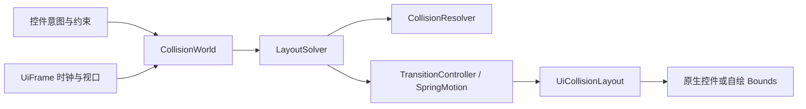

<!-- 作者：山海／dishanhai -->
# 二维 UI 弹性挤压

## 架构与生命周期

`client.gui.collision` 是 Java 17 共享核心。`CollisionShape` 定义 GUI 逻辑坐标中的浮点 AABB，`CollisionBody` 保存布局意图和约束，`CollisionResolver` 选择并执行一对矩形的修正，`LayoutSolver` 传播修正，`CollisionWorld` 管理分组、脏状态和事件。`TransitionController` 维护每个控件的过渡，`SpringMotion` 复用现有 `Spring`，独立于求解器。

`client.api.UiCollisionLayout` 使用 `UiApiContext` 管理生命周期，接收 `UiFrame.viewport()`、`nowMs()` 和 `preferences().reducedMotion()`。宿主在 `UiScreenBuilder.onInit` 更新尺寸意图并绑定原生控件，在 `onRender` 绘制控件前推进布局。尺寸重建可保留 world 和 body，替换已重建控件的绑定。原有 Screen 负责渲染、裁剪、鼠标捕获、焦点和旁白。核心和适配层走 Forge 1.20.1 的 Java 17 及 NeoForge 1.21.1 的共享源码路径。



## 接口

| 类型 | 入口和职责 |
| --- | --- |
| `CollisionShape` | `new CollisionShape(x, y, width, height)`，查询边缘、交集和半开命中 |
| `CollisionWorld` | `new CollisionWorld(viewport)`，链式 `viewport`、`axis`、`onCollision`，`add`／`remove`，`update(nowMs, reducedMotion)` 返回当前未解决约束数 |
| `CollisionBody` | 链式 `desired`、`moveTo`、`resize`、`strategy`、`priority`、`compression`、`anchor`、`group`、`direct`，查询 `desired`、`target`、`visual` |
| `CompressionModel` | 最小宽高、最大宽高和正阻力。`resize` 按锚点调整期望位置，`desired` 直接指定矩形 |
| `CollisionResolver` / `LayoutSolver` | 两体碰撞查询和投影、分组迭代与降级。可用 `new CollisionWorld(viewport, new LayoutSolver(maxPasses))` 调整迭代预算 |
| `SpringMotion` / `TransitionController` | 单标量弹簧、四通道矩形动画。`retarget` 保留瞬时速度，`snap` 用于直接操控与减少动效 |
| `CollisionEvent` | `CONTACT` 表示本轮曾相交，`UNRESOLVED` 表示降级后仍相交，`BOUNDARY_CLAMPED` 表示意图被视口限制，`MINIMUM_CLIPPED` 表示视口小于个体最小尺寸 |
| `UiCollisionLayout` | `world()`、`bind(body, widget)` 或 `bind(body, Consumer<Bounds>)`、`unbind`、`update(frame)`、`hitTest`，随 `UiApiContext` 关闭 |

Java 链式配置示例

```java
var panel = layout.world().add(new CollisionShape(80, 24, 60, 28))
        .strategy(CollisionBody.Strategy.ELASTIC)
        .priority(10)
        .anchor(CollisionBody.Anchor.CENTER, CollisionBody.Anchor.START)
        .compression(new CompressionModel(40, 28, 140, 28, 2));
panel.resize(120, 28);
```

Kotlin 侧可直接用 Java API，也可以用可选的 `world.collisionBody(shape) { ... }` 扩展配置 body。核心调用者只需要 Java 类型。

```kotlin
val panel = world.collisionBody(CollisionShape(80f, 24f, 60f, 28f)) {
    priority(10)
    strategy(CollisionBody.Strategy.ELASTIC)
    anchor(CollisionBody.Anchor.CENTER, CollisionBody.Anchor.START)
}
```

## 接入原生 Screen

在 `onInit` 里登记控件，并应用初始几何。下面的 `layout` 和 `panel` 为该页面持有的字段，`label` 由宿主提供本地化文本。宿主在窗口缩放时保留 body 和动画，根据新视口更新 `desired` 并用新控件重绑。返回页面后，由新上下文重新建立布局。

```java
var builder = new UiScreenBuilder(title)
        .onInit(page -> {
            var viewport = page.viewport();
            if (layout == null) {
                layout = page.context().collisionLayout(viewport);
                layout.world().axis(CollisionWorld.Axis.HORIZONTAL);
                panel = layout.world().add(new CollisionShape(0, 0, 60, 24)).priority(10)
                        .anchor(CollisionBody.Anchor.CENTER, CollisionBody.Anchor.START);
            }
            panel.moveTo(viewport.x() + 82 - panel.desired().width() / 2, viewport.y() + 8);
            var button = page.button(0, 0, 60, 24, label,
                    () -> panel.resize(panel.desired().width() == 60 ? 100 : 60, 24));
            layout.bind(panel, button);
            // 同法登记并绑定左、右相邻控件，扩展时由 world 重新分配空间。
            layout.update(viewport, page.context().motion().nowMs(),
                    page.context().preferences().reducedMotion());
        })
        .onRender((page, frame) -> {
            layout.update(frame);
            DarkModeTheme.background(frame.graphics(), 0, 0, page.width, page.height);
        })
        .onRemoved(page -> {
            layout = null;
            panel = null;
        });
```

拖拽由宿主捕获指针、保留抓取偏移并调用 `body.direct(true).moveTo(x, y)`。释放时调用 `direct(false)`，取消时恢复拖动前的意图再退出直接操控。缩放宿主可用 `resize` 保持配置锚点，或用 `desired` 自行提交以指针为锚点的矩形。

## 约束与求解

使用矩形宽相位和有界顺序投影。一次更新把同帧的全部意图一起求解。几何、约束和增删改变时标记对应组，迁组标记两边，视口或轴模式变化标记所有组。组内从期望矩形重建目标，以优先级降序和注册序处理两体约束，并交替遍历传播链条。分组互相独立，共享视口。静止或仅动画推进时跳过求解，复用工作矩形、组列表和事件暂存。

相碰时，分别估计两轴所需分离量及可用空间。`HORIZONTAL`、`VERTICAL` 固定解算轴，`AUTO` 优先选择可完整分离且修正较小的轴。方向优先沿用上一布局的中心顺序，中心相同时依次看意图中心和注册序。`Avoid` 在 `AUTO` 优先尝试中心主方向的垂直轴，容量不足时使用另一轴。几何边缘接触不算相交，求解器另外使用 0.0001 GUI 单位的浮点容差。

| 策略 | 该控件允许的修正 |
| --- | --- |
| `PUSH` | 沿碰撞法向平移，保持尺寸 |
| `COMPRESS` | 按锚点缩到最小值，保持锚点 |
| `AVOID` | 保持尺寸，可在自动模式绕向侧轴 |
| `OVERLAY` | 略过组内碰撞，仍受自身尺寸和视口约束 |
| `ELASTIC` | 优先按锚点压缩，再使用剩余平移空间。贴边时允许同时缩短与平移 |
| `RESIST` | 保留受视口限制后的意图，邻项负责修正 |

低优先级先让出空间，容量耗尽后才尝试高优先级。同级可压缩控件按阻力倒数分摊面向接触边的位移，饱和后由剩余一方承接。锚点决定缩小时的实际边缘位移。连锁被边缘卡住时，具有共同截面的平移链先为全链预留宽度或高度，再按优先级选位。其他组可在剩余迭代中让高优先级平移项先分担少量位移。迭代结束仍有冲突时，按优先级与注册序从意图重新摆放，已放置的控件作为障碍，记录残余冲突。个体最小尺寸大于视口时按视口裁减并发事件。复杂 2D 装箱采用有界启发式，可能留下确定性的残余交叠。

## 帧与命中

意图、求解目标和呈现矩形独立。位置、宽和高的弹簧使用同一个帧时钟，改目标保留当前速度。复用 `Spring` 的 50 ms 追赶上限和不超过 4 ms 的子步。直接操控可立即呈现受约束的目标，邻项继续过渡。首次布局和减少动效立即应用目标。呈现几何受尺寸上下限与当前视口约束。

适配器将呈现矩形按四边四舍五入一次，得到绘制和命中共用的 `Bounds`。屏幕裁剪、悬停和点击使用逻辑 GUI 坐标。动画交叉及降级允许暂时交叠。宿主自绘层按绑定顺序绘制，用 `hitTest` 以反向绑定顺序选中最上层。原生控件沿用宿主的输入分发和焦点顺序，需允许可点击控件交叠的页面应自行按顶层命中分发。主体装饰超出矩形时由宿主裁剪。

## 实现和验证顺序

1. 在共享测试中固定两侧展开、同轴链条、边界、阻力与优先级、锚点、分组、六策略、不可满足最小尺寸、多控件同帧更新和确定性结果。实现 AABB、分组、成对投影和降级。
2. 增加连续展开收起、反向保速、144 Hz 与 20 Hz、长暂停、重复帧时间和减少动效测试。实现弹簧和矩形呈现。
3. 用现有 `UiFrame` 和 `UiApiContext` 接入适配层，测试视口和 GUI Scale 变化后的裁剪、像素量化、绑定生命周期、上层命中。补 Kotlin 扩展。
4. 分别运行根目录 Gradle 8.8 的 `test build` 和 `neoforge/gradlew.bat -p neoforge test build`，核对测试报告和两端 JAR。客户端验收涵盖真实 GUI Scale、拖动和反向展开、重建绑定、焦点、旁白及资源重载。
