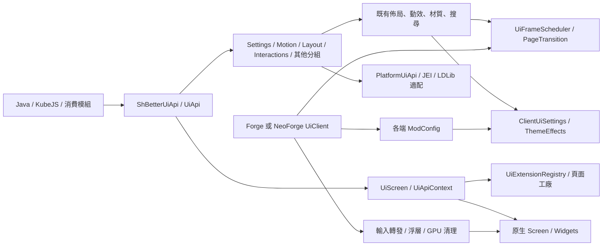

<!-- 作者：山海／dishanhai -->
# Unified UI Kernel 工程審計

2026-11-09 至 2026-11-10，SH-Better-UI `main`，已提交基線 `553d4f0`。審計同時讀取當前工作樹和隔離的 HEAD 快照。工作樹含搜尋、玻璃材質、情境主題、碰撞及資源的進行中改動。下文以「工作樹」標記這些能力，避免將其算入已發行的契約。

## 建置和發行邊界

| 項目 | Forge | NeoForge |
| --- | --- | --- |
| 工程 | 根目錄的獨立 Gradle 工程，沒有根 wrapper | `neoforge/` 獨立 Gradle 工程 |
| Minecraft／Loader | 1.20.1／47.4.16 | 1.21.1／21.1.251，FML 4.0.44 |
| Gradle／插件 | 本機 8.8，ForgeGradle `[6.0,6.2)` 本次解析為 6.0.54，Librarian `1.+` 解析為 `1.2.0.7-dev-SNAPSHOT` | Wrapper 9.2.1，ModDevGradle 2.0.148 |
| 映射 | Parchment `2023.09.03-1.20.1`，正式包走 `reobfJar` | Mojang 命名，NeoForm `1.21.1-20240808.144430`，此工程未配置 Parchment |
| Java／Kotlin | 生產 Java／Kotlin 17，Gradle 啟動及 JUnit 測試使用 JDK 21.0.11 | 生產和測試 Java／Kotlin 21，Gradle 以 JDK 21.0.11 啟動 |
| 依賴 | Kotlin 插件 2.2.21，外部 KFF 4.12.0，LDLib 1.0.33.b、JEI 15.49.0.200、KubeJS 2001.6.5-build.26 走選用適配 | Kotlin 插件 2.2.21，外部 KFF 5.10.0，LDLib2 2.2.44、JEI 19.69.0.456、KubeJS 2101.7.2-build.381 走選用適配 |
| 源碼及資源 | `src/main/java`、`src/main/kotlin`、`src/main/resources` | 共用上述源集，排除 13 個 Forge Java 類和 Forge LDLib Kotlin 適配，再加入 14 個 NeoForge Java 類及獨立模組描述 |
| 工作樹產物 | `build/libs/sh_better_ui-1.0.4.jar` 及 `-dev.jar`、`-sources.jar` | `neoforge/build/libs/sh_better_ui-neoforge-1.21.1-1.0.4.jar` 及 `-sources.jar` |

版本採用 [Forge 建置](../build.gradle)、[Forge 屬性](../gradle.properties)、[NeoForge 建置](../neoforge/build.gradle)、[NeoForge 屬性](../neoforge/gradle.properties) 與隔離快照的 `buildEnvironment` 和 NeoForm artifact manifest。兩端 `settings.gradle` 均只宣告 root project。Forge 發行包檢查重映射結果、類與資源完整性，NeoForge 檢查自己的適配類和資源。兩端均防止內嵌外部依賴。KFF 由使用端獨立安裝。

Forge 1.20.1 和 NeoForge 1.21.1 的目標 JDK 分別為 17 和 21。以 JDK 21 啟動建置可保留現有 Forge 測試中的 Java 21 API，核心契約仍須獨立在 Java 17 編譯與執行。 [Forge 1.20.1 環境](https://docs.minecraftforge.net/en/1.20.1/gettingstarted/) · [NeoForge 1.21.1 環境](https://docs.neoforged.net/docs/1.21.1/gettingstarted/)

## 現有能力與接入點

| 領域 | 現有入口和實際權責 | 中央引擎可復用的部分與缺口 |
| --- | --- | --- |
| 公開 API | [ShBetterUiApi](../src/main/java/com/dishanhai/sh_better_ui/client/api/ShBetterUiApi.java) 提供 14 個分組單例、`client()`、`context()`、`screen()`、`extensions()` 及 `developerPreviews()`。`UiApi` 由客戶端、頁面上下文和 KubeJS 共用。分組主要是既有物件的工廠和繪製便利方法。 | 保留所有呼叫簽章。由中立服務適配器復用底層物件。現有分組多數仍使用 `Screen`、`GuiGraphics` 或原生控件型別，需留在 Minecraft 相容層。 |
| 註冊 | [UiExtensionRegistry](../src/main/java/com/dishanhai/sh_better_ui/client/api/UiExtensionRegistry.java) 用命名空間字串和 `Class<T>` 註冊工廠，檢查重複、提供關閉句柄，工廠在鎖外執行。[PreviewRegistry](../src/main/java/com/dishanhai/sh_better_ui/client/api/preview/PreviewRegistry.java) 發布排序的不可變預覽清單。`UiTextEffects` 另有文字效果註冊。 | 復用型別檢查、穩定快照、舊句柄身分檢查。頁面擴充、展示範例、文字樣式各有自己的生命週期。缺少服務契約版本、模組依賴圖、權限、凍結和能力解析。 |
| 生命週期 | [UiApiContext](../src/main/java/com/dishanhai/sh_better_ui/client/api/UiApiContext.java) 懶解析頁面擴充，按物件身分去重與逆序關閉，保留已解析實例直到上下文關閉。[UiScreen](../src/main/java/com/dishanhai/sh_better_ui/client/api/UiScreen.java) 在移除時回收上下文，同頁重開取得新上下文。KubeJS 重載會關閉舊腳本的登記、頁面和上下文。 | 復用清理語義與原生父頁、有效焦點恢復。缺少引擎、模組、會話、樹和組件的層級關閉，以及跨作用域取消。 |
| 時鐘與調度 | [UiFrameScheduler](../src/main/java/com/dishanhai/sh_better_ui/client/UiFrameScheduler.java) 提供單調幀時鐘、幀尾動作、活動 Screen 驗證和掛載生命標記。父頁預繪共用幀時間並抑制提交。`UiClientApi.run` 和 `UiRequest` 用 `Minecraft.execute` 交回客戶端。 | 保留幀首時間、幀尾檢查與預繪抑制。`UiRequest` 已有 UUID、連線與逾時判斷。缺少分階段、有界、具所有者和取消的任務佇列。 |
| 動畫 | `MotionApi`、`Spring`、`SpringTable`、`InterruptibleAnimation`、`UiTimeline`、`PageTransition`、膠囊／換頁及後景過渡。每個宿主持有軌道，支援優先級、保速重定向與單次完成。 | 復用時間採樣、插值、彈簧與終止語義。需為同一組件屬性引入可取消的獨占租約及活動軌道集合。 |
| 佈局 | `UiLayout`、`GraphicDisplayLayout`、`NetworkLayout` 計算固定、列欄與分頁。[AlignmentLayout](../src/main/java/com/dishanhai/sh_better_ui/client/gui/layout/AlignmentLayout.java) 有相對約束、依賴順序、髒節點、像素吸附、呈現與命中幾何和重算計數。 | 復用幾何與增量解算。需補中立樹的 measure／arrange、容器規則和統一的失效傳遞。 |
| 輸入與焦點 | `InteractionApi`、`UiPointerTracker`、`UiPointerCapture`、`UiOverlayHost`、`UiLocalModal`，以及原生 Screen／Widget 的焦點順序和旁白。兩端 `UiClient` 在 `ScreenEvent.*.Pre` 轉發，既有層依順序決定是否取消原版處理。 | 保留原生鍵盤、拖曳與釋放消化規則。新 UI 樹需捕獲／目標／冒泡路徑、焦點／模態權威、作用域和可選阻斷原版的授權。 |
| 碰撞 | 工作樹的 [CollisionWorld](../src/kernel/java/com/dishanhai/sh_better_ui/client/gui/collision/CollisionWorld.java) 按組髒標記求解，迭代受限，`UiCollisionLayout` 將呈現矩形寫入原生 Widget 並提供反向綁定序的自繪命中。 | 復用投影、降級和四通道動畫。原生控件交疊仍由宿主的順序處理。需獨立於擠壓求解的命中／遮擋策略及空間索引。 |
| 主題與設定 | `SettingsApi`、`MaterialsApi`、`ClientUiSettings`、`ThemeSettings`、`UiTheme` 和 `ThemeEffects` 支援深淺／自訂、分組 JSON、逐幀草稿預覽。兩端載入和保存同名 TOML。審計期間工作樹新增 `ThemeRegistry`、`ThemeResolver`、`ThemeScope`、型別 token 與 style 綁定，`theme.context` 已有情境快照和規則解析。 | 復用現有驗證、色板及偏好。對進行中的主題模組，保留其定義註冊、token 依賴與樣式作用域。內核補通用配置 schema、交易、生命週期和資源包提交，待主題基線可建置後適配。 |
| 繪製與資源 | `GraphicsApi`、`BlurApi`、`GaussBlur`、`UiFrameHandoff`、`AlignmentAssets`、圖示與 SDF／字形快取。共用 [UiClientRendering](../src/main/java/com/dishanhai/sh_better_ui/client/UiClientRendering.java) 組合局部模態、浮層、Toast，雙端各自註冊著色器、重載和 Screen Post。 | 保留既有 blur 和清晰前景順序。需中立命令、pass／target 所有權、重載世代、分階段釋放及快取失效。 |
| 無障礙 | `UiPreferences` 含減少動效、高對比等偏好。原生按鈕、搜尋、模態和選取器提供可見焦點、按鍵和旁白。 | 復用偏好與原生能力。需中立語義角色、樹上的鍵盤導覽和平台能力狀態。 |
| 狀態、事件及診斷 | 目前使用 Loader 事件、控件回呼、`UiRequest`、音樂快照及各自的狀態模型。已有佈局重算、資產命中計數及部分繪製診斷。 | 保留業務操作的伺服器回執邊界。缺少內核的型別事件、狀態與設定交易、命令、權限、租約和共通取樣指標。 |

完整舊介面以 [API_REFERENCE.md](API_REFERENCE.md)、[SCREEN_INTERACTIONS.md](SCREEN_INTERACTIONS.md)、[KUBEJS.md](KUBEJS.md) 與實際類簽章為準。

## 依賴和重複路徑

- 雙端 `UiClient` 重複大量輸入轉發、登出和重載流程。`UiClientRendering` 已抽出共用浮層順序，後續從事件轉譯層往同一個中立路由收斂。單軸／雙軸滾輪、事件註解和註冊方法留在平台側。
- 雙端 `ShBetterUi` 重複 TOML 欄位與值轉換，Loader config spec、讀寫 API 與同步機制不同。現有 TOML 仍由各 Loader 持久化，中央 schema 負責驗證與發布一份有效快照。
- 模態、局部模態和指標捕獲各自處理焦點與輸入優先序。`UiOverlayHost` 支援宿主原生容器，`UiLocalModal` 只遮擋局部，兩者各有有效語義。遷移以租約統一資源仲裁，保留各自的互動。
- 工作樹的 [ThemeRegistry](../src/main/java/com/dishanhai/sh_better_ui/theme/ThemeRegistry.java) 分離程式及資源定義，[ThemeScope](../src/main/java/com/dishanhai/sh_better_ui/theme/ThemeScope.java) 已有分支關閉、token 依賴索引與有界樣式快取。這是主題領域的資料和作用域，接入時由中央掛載持有其生命週期，對其公開驗證介面作授權。
- 共用源集替換類是既有相容手段。`PlatformUiApi$LdLib`、流體、Tooltip 及 Shader 差異已刻意隔離。兩端同名類的原生簽章需要分別記錄 ABI。

## 相容性、執行緒和效能風險

| 風險 | 證據及影響 | 接入約束 |
| --- | --- | --- |
| ABI 與可選依賴 | `UiApi` 是既有可實作介面，`UiFrame` 是含 `GuiGraphics` 的 record，`PlatformUiApi` 有載入器專屬簽章。`UiExtensionRegistry` 支援運行期撤銷並保留已建立實例。 | 新增純 Java 契約。保留 JVM 簽章、建構式、預設方法和 KubeJS `SHUI`，以兩端基線 JAR 驗證。第三方可在原生或選用依賴缺席時載入中立 API。 |
| 版本漂移 | Forge 使用兩個動態插件版本，現有 API 索引和舊驗證記錄所述版號也與工作樹不同。 | 構建日誌記錄實際解析版本，遷移期間以當次測試的 JAR 與建置設定為準。 |
| 原生輸入／渲染 | Forge 滾輪事件只給單一增量，NeoForge 提供 X/Y。兩端 `ScreenEvent.KeyInput` 只帶 key、scan、modifiers，字元事件型別是 `char`。父頁預繪、原生延遲 Tooltip 和 Screen Pre 取消可能讓預期 Post 缺席。 | 對固定版本的事件和原生回呼做契約測試。輸入取消同步決定，並在無活躍範圍時放行。渲染上下文只在合法回呼中有效。 |
| UI 執行緒 | `UiApiContext`、動畫、佈局、碰撞和捕獲以單執行緒為使用約定，沒有共通入口強制。Frame/Theme 使用 ThreadLocal，資源準備有 Loader 的背景 executor，GL 上傳和釋放需要渲染執行緒。 | 客戶端掌握狀態寫入，背景只產出不可變資料。發布、關閉與過期結果都檢查作用域世代。 |
| 並行可見性 | `UiExtensionRegistry` 鎖保護登記，頁面工廠可重入。`ClientUiSettings` 及部分偏好是分立快照，載入、保存和使用可能在不同路徑。 | 新服務拓撲及設定／狀態以不可變快照一次發布。回呼在鎖外執行，關閉時先封鎖新操作。 |
| 每幀工作 | `UiFrameScheduler` 幀尾佇列無容量限制，前一回呼拋錯時會結束本次 drain。當前 `AlignmentLayout` 能跳過乾淨佈局，但每次髒批次建立排序佇列。 | 用有界的階段工作集合、固定生命週期和模組配額，維持無髒資料時的快路徑。 |
| 命中與碰撞 | `CollisionWorld.update` 仍走訪所有 body 的呈現。`LayoutSolver` 對髒組多輪做兩兩檢查，單組 10,000 個節點每輪約 5,000 萬對。`UiCollisionLayout.hitTest` 線性查詢。 | 保留小組演算法，先測量分組／密集壓力。命中索引與碰撞解算各自驗證，不在 Phase 0 假定切換門檻。 |
| 快取和繪製 | `ThemeEffects` 在同步路徑按群組和 fallback 解析，配色預覽可交替觸發；`AlignmentAssets` 由宿主呼叫 `invalidate`。Blur 有幀末清理，GPU 資源、圖片解碼、字形等各有釋放路徑。 | 測量快取失效、重載和多根畫面的分配，保留現有 render pass、裁剪與 scissor 邊界。 |

滾輪與字元簽章取自固定版本的 Forge／NeoForge sources JAR。事件取消的語義可對照兩個 Loader 的上游源碼。 [Forge ScreenEvent](https://github.com/MinecraftForge/MinecraftForge/blob/1.20.x/src/main/java/net/minecraftforge/client/event/ScreenEvent.java) · [NeoForge ScreenEvent](https://github.com/neoforged/NeoForge/blob/1.21.1/src/main/java/net/neoforged/neoforge/client/event/ScreenEvent.java)

## Phase 0 驗證

以 Git Bash 設定 `JAVA_HOME=/c/Program Files/Java/jdk-21.0.11`、`TEMP=TMP=C:\jtmp`，直接啟動 Gradle。隔離 HEAD 由 `git archive 553d4f0` 展開，只補 Forge 建置明列的兩個本機依賴。快照和日誌位於 `C:/jtmp/shbui-kernel-audit.PsbEFL`。2026-11-10 00:07 左右另擷取包含轉場程式的工作樹到 `C:/jtmp/shbui-kernel-worktree.Gy0DPX`，兩端從該副本重跑。

| 對象 | 執行 | 結果 |
| --- | --- | --- |
| 工作樹的首次基線 | 根 Gradle 8.8 與 `./neoforge/gradlew -p neoforge` 分別執行 `build --offline --no-daemon --console=plain` | 兩端均在 `compileJava` 失敗。當時 `ThemeRule`、`ThemeRuleResolver` 引用缺少的 `theme.transition.TransitionSpec`，各報 9 個錯誤。該輪未達 JUnit 與打包。審計期間新進主題程式與測試另須重建基線。 |
| 隔離 HEAD | 兩端 `build buildEnvironment --offline --no-daemon --console=plain` | Forge 710 項、NeoForge 712 項 JUnit 各有 1 項失敗。`MusicServiceTest.supersededLyricsCannotAttachToAnotherTrack` 第 91 行預期 `new`，讀到 `old`。`MusicService` 先取消舊 Future 再發布新 `LOADING` 快照，測試 latch 只等待中斷，未等待快照發布。 |
| 隔離 HEAD | 兩端獨立執行 `verifyLibraryJar --offline --no-daemon --console=plain`，再統計發行包 class 版本 | 通過。Forge `1.0.3` reobf 包 780 個 class，皆 major 61。NeoForge `1.0.4` 包 760 個 class，皆 major 65。 |
| 更新後的隔離工作樹 | 兩端 `verifyLibraryJar build --offline --no-daemon --console=plain`，讀取 JUnit XML 與發行包 class 版本 | 兩端皆通過，含 Forge 重映射與兩端封裝檢查。Forge 780 項 JUnit，發行包 867 個 class 皆 major 61。NeoForge 782 項 JUnit，發行包 846 個 class 皆 major 65。兩端均零失敗、零錯誤、零跳過。 |
| 目前工作樹 | `python -B -m unittest discover -s src/test/python -v` | 7 項中 3 項失敗。分別為掃描將 `PlatformUiApi` 的可選 LDLib 簽章納入核心、消費方依賴下限已用 Gradle 變數、`program/shop_gauss_blur.json` 雜湊不同。這組抽取契約依賴相鄰 `gt_shanhai`，Gradle `test` 不執行它。 |

歌詞測試在後一輪兩端均通過。已觀察的時序問題仍列入遷移基線，驗收以被測快照發布為同步條件。以上成果對應擷取的快照，後續整合前須再次凍結實際源碼範圍。

兩端已有共用 JUnit 5.10.2 測試，覆蓋原生入口隔離、擴充清理、幀尾掛載、碰撞、主題、動畫、輸入與 shader 契約。另有 NeoForge 專屬入口測試及歌詞／HTTP 整合測試。已找到 `runClient`、`runServer` 和開發者圖庫，尚未找到已接線的 GameTest、用戶端自動驗收或 100／1,000／10,000 節點效能基準。本次未啟動 Minecraft。

## 內核新增面

建議以 `UnifiedUI`／`UIEngine`、`ServiceKey`／`ServiceDescriptor`、`ModuleDescriptor`／`ModuleContext`、`CapabilityResolver`、`ScopeHandle`、`UIScheduler`、`UIConfigCenter`、`UIStateStore`、`UIEventBus`、`UICommandBus` 和 `UIPlatform` 建立中立契約。介面的讀寫授權、既有入口接線和凍結方式見 [架構](kernel-architecture.md)。驗收順序和基線門檻見 [遷移計畫](kernel-migration-plan.md)。
