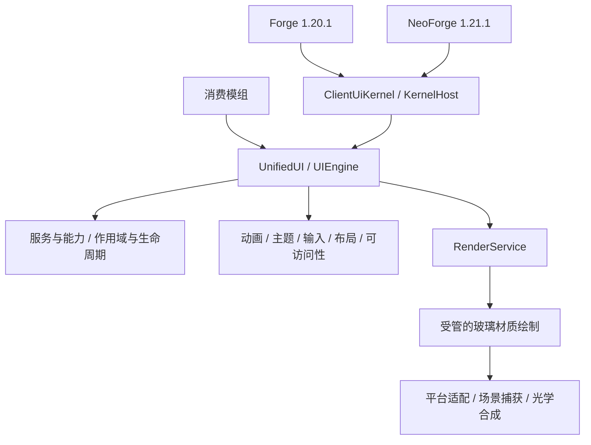

<!-- 作者：山海／dishanhai -->
# Unified UI Kernel 与 Liquid Glass 架构审计

审计日期 2026-11-10。以 `main` 的 `d87e31e` 和当前工作区为起点。Live Surface、Spatial、客户端主题和模糊 Shader 在工作区已有改动，以下将已接线的代码与待取得的验证证据分开记录。

## 工程边界

| 层 | 当前入口 | 处理方式 |
| --- | --- | --- |
| 公共内核 | `src/kernel/java`、`src/kernelTest/java`、`gradle/kernel.gradle` | 两端共享 Java 17 契约，继续由 `UnifiedUI.get()` 发布 `UIEngine`。 |
| Forge 1.20.1 | 根 `build.gradle`，Forge 47.4.16，Java 17 工具链，Gradle 8.8 | 共用 `src/main` 的 Java、Kotlin 与资源，平台入口为 Forge `UiClient` 与 `ForgePlatformBridge`，产物在 `build/libs/`。 |
| NeoForge 1.21.1 | `neoforge/build.gradle`，NeoForge 21.1.251，Java 21 工具链，Gradle 9.2.1 | 共用源码及资源，平台替换类位于 `neoforge/src/main`，产物在 `neoforge/build/libs/`。 |
| 消费端 | `UIApis`、`ModuleContext`、`examples/kernel-extension` | 保留现有 Java 签名、Loader 发现机制及独立模组依赖。 |

图中的受管玻璃绘制和场景捕获是本计划的接入点。现有调用关系见 [内核架构](kernel-architecture.md)。

## 与目标的差异

| 范围 | 已有 | 缺口 |
| --- | --- | --- |
| 启动、服务、模块 | `EnginePublication` 原子发布，`ModuleDiscovery` 验证 Loader 来源，`ServiceRegistry` 校验 ID、Java 类型和契约版本，`DependencyGraph` 排序并检查环，`EngineLifecycle` 保留受权限控制的诊断。 | 被替换的服务在注册结束后就失去后备资格。替换者未启动、初始化失败或停止时，服务目录可能缺项。原生启动阶段被依赖图隔离的有效候选只留下诊断文字，模块状态缺项。 |
| 渲染与资源 | `ClientRender` 按原生 Screen 或 HUD 和作用域调度，`ClientResources` 接到原生重载，`GaussBlur` 有按尺寸重用的 `PostChain`。 | 模糊路径与中央绘制阶段的背景共享、目标预算、GL 状态和降级证据尚未统一。需区分画面捕获与材质的绘制次序。 |
| 光学与材质 | `GlassStyle`、`GlassSurface`、`GlassTheme`、`LiquidGlassTheme` 和 `shop_gauss_blur.fsh` 已实现着色、SDF 圆角、边缘位移、边缘光与柔影。 | 公开的受管材质入口、同一背景的多区域透射、稳定的环境调节、几何及质量契约仍需实现或实测。既有视觉预设保留其语义。 |
| 动画与输入 | `AnimationService`、`Spring`、`FluidMorph`、`UiTimeline`、`InputService`、`FocusService` 和中央事件相位。 | 需要让同一呈现几何驱动光学和命中，验收动画打断、拖动取消、事件消费、焦点返回及减少动效。 |
| 主题与空间 | `ThemeService` 与动态 token 分支、`AccessibilityService`、`LayoutService`、`CollisionService`。工作区已有 Spatial 场景及 Live Surface 避让。 | 玻璃的材质语义和光学参数还需要接到 token、层级、裁剪和用户无障碍偏好。 |
| 组件与示例 | `UiButton`、`UiToggleButton`、`UiSlider`、现有面板与图库，工作区有 Live Surface 仲裁和示例。 | 需要选取共用控件接入受管玻璃入口，补齐其余组件的语义、操作和示例，验证文字与前景内容在材质之后绘制。 |
| 测试与性能 | 两端共享的 `kernelTest`，控件、主题和 Shader uniform 契约测试，`gradle/kernel-smoke.init.gradle`、原生 benchmark 入口。 | 需在同一代码快照核对双端运行，取得背景透射和边缘折射截图、重载与 GL 状态证据，以及可复现的 CPU、GPU、内存与分配记录。 |

## 视觉验收依据

- 将玻璃放在导航和主要操作层，背景内容透过操作层保持可见。避免层层叠加玻璃，标签及前景内容保持清晰。 [Apple HIG · Materials](https://developer.apple.com/design/human-interface-guidelines/materials)
- `REGULAR` 作为自适应默认值，适合较多文字或对比易受背景影响的场景。`CLEAR` 用于丰富的图像背景，在需要时对背景调暗来保护前景。每组操作控件采用一致的变体。 [Apple HIG · Materials](https://developer.apple.com/design/human-interface-guidelines/materials) · [WWDC25 · Meet Liquid Glass](https://developer.apple.com/videos/play/wwdc2025/219/)
- 截图逐项检查环境适应、边缘厚度、自然透镜、动态高光、柔影和前景对比。动态场景另验收形变时的连续性、焦点、减少动效、降低透明度与高对比。Shader 参数由本项目标定。 [Apple Design](https://developer.apple.com/design/) · [Apple Human Interface Guidelines](https://developer.apple.com/design/human-interface-guidelines/) · [WWDC25 · Meet Liquid Glass](https://developer.apple.com/videos/play/wwdc2025/219/)

完整阶段边界、文件和命令见 [实施计划](liquid-glass-kernel-plan.md)。
