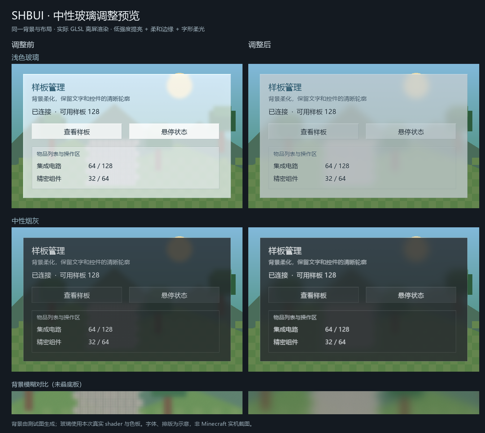
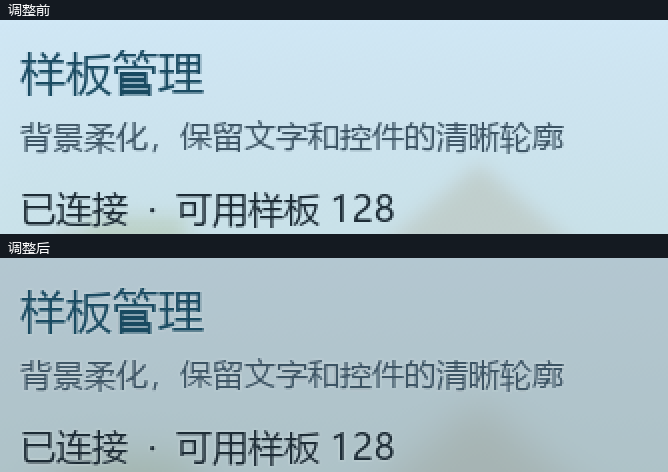

<!-- Author: dishanhai -->
# 中性玻璃顯示維護 · 2026-11-07

## 結果與接入

- 淺色版改為柔和淺灰，底板與控制項統一讀取 GlassColors.CLEAR；獨立按鈕保留文字承托底，面板內按鈕只薄疊色。
- 整體提亮保留：CLEAR 的 lift 0.035 → 0.008，rim 0.55 → 0.18；煙灰 FROSTED 使用 lift 0.004、rim 0.10。文字周邊採使用者確認的字形柔光。
- 淺灰／煙灰背景專用 65 點高斯（每趟），半徑分別 14／16 GUI 單位；獨立淺灰按鈕 8。原有飛行、切頁核與面板內避免重複取樣的路徑保留。
- GlassSurface.drawString 提供 String／FormattedCharSequence 兩個入口，復用原版 Font.drawInBatch8xOutline；outline alpha 為 12/255，隨顯式文字 alpha 下降。低於原版安全門檻時省略描邊，避免淡出變成白框。
- GlassTheme.SMOKE 的居中文字已接入；其他消費端直接調用 graphics.drawString 的文字不會被自動攔截，按 README 示例接入新入口。本輪未修改 gt_shanhai。

## 文件／位置／內容

| 文件 | 位置 | 內容 |
|---|---|---|
| GlassColors.java | CLEAR | 淺灰底板、薄內層、低亮度高光 |
| GlassSurface.java | panel / control / smokePanel / drawString | 統一色板、模糊半徑、獨立按鈕承托與字形柔光 |
| GlassTheme.java | drawCentered / backdrop | 煙灰居中文字柔光及共用煙灰模糊 |
| GlassStyle.java | CLEAR / FROSTED / blurMode | 微量提亮、弱邊光、專用密採樣路由 |
| Forge／NeoForge GaussBlur.java | applyUniforms | 上傳對應採樣模式 |
| shop_gauss_blur.fsh | Smooth > 1.5 | 65 點毛玻璃核；舊有模式保留 |
| GlassColorsTest / GlassStyleTest / GlassTextGlowTest | 測試 | 疊色、文字對比、提亮與路由、淡出 alpha、獨立按鈕 |
| test_extraction_contract.py / extraction-baseline.json | shader 基準 | 保留抽取時歷史 hash，另鎖定本次維護後的 shader hash |

## 驗證

- Forge：`gradle.bat test build --offline --no-daemon --console=plain` 成功；135 項 JUnit，0 failures/errors。
- NeoForge：`neoforge/gradlew.bat -p neoforge test build --offline --no-daemon --console=plain` 成功；137 項 JUnit，0 failures/errors。
- 兩平台 verifyLibraryJar 通過；Forge 正式包與 reobf 輸出 SHA-256 相同。
- Forge SHA-256：`4145975D113500A9623464EE0BBC25D57697913CEAC9A827DF1AFA6B26EB3A25`。
- NeoForge SHA-256：`015EE3D6CCBF3E9BCD14B90DA8C1A2AD219CB7B2F0FCBA26A3CA5A607C599BFE`。
- Python：7 項，6 通過；既有 `test_independent_identity_and_explicit_consumer_dependency` 仍因寫死 `[1.0.0,2.0.0)` 而失敗，實際消費端使用版本變量；本次 shader 基準通過。
- `git diff --check` 通過；離屏驗證與 GitHub 交付均未部署或啟動 Minecraft。

## 渲染預覽與證據邊界

- `build/previews/GlassShaderPreview.java` 使用現有 LWJGL，建立不可見 OpenGL 3.3 context，在 NVIDIA GeForce RTX 4060 Laptop GPU（610.88）執行。
- 修改前 shader 取自本輪前的 HEAD；修改後使用實際資源檔，搭配實際 GlassStyle 參數，分別完成淺灰／煙灰兩趟 H/V 模糊。兩套 GLSL 編譯、連結及四組渲染均成功，GL_NO_ERROR。
- 背景是自製測試圖；底板使用實際色板合成。字體、排版及字形柔光示意由 Pillow 生成，未使用 Minecraft Font 或遊戲介面。
- 圖片可以比較材質與模糊，不能視為遊戲字體、GUI scale、資源包、第三方 shader、完整 Screen／LDLib 行為或效能驗收。剩餘驗收見 TODO.md。

