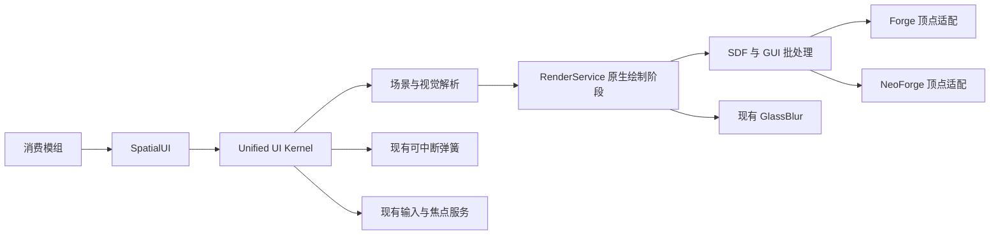

<!-- 作者：山海／dishanhai -->
# Spatial UI 架构

`SpatialUI` 通过 Unified UI Kernel 发布。业务模组在模块、会话或已挂载的界面节点下创建场景，作用域关闭会撤下场景和所有动画。公共场景、样式和矩阵位于共享 Java 17 源集。

## 工程审计

| 职责 | 沿用入口 | 空间扩展 |
| --- | --- | --- |
| 注册、作用域、配置 | `ClientUiKernel`、`BuiltinService`、`ClientUiSettings` | 发布一个服务并跟随现有客户端生命周期 |
| 动态主题 | `ThemeService`、`ThemeManager`、`ThemeScope` | 解析屏幕或组件作用域中的表面和阴影色 |
| 运动 | `InterruptibleAnimation`、`Spring`、`UIPhase.ANIMATION` | 每个空间属性仅绑定一条活动轨道 |
| 对齐、布局、碰撞 | `LayoutService`、`CollisionService` | 布局完成后由调用方提交节点局部坐标和形状 |
| 输入、焦点 | `InputService`、`FocusService`、`ScreenService` | 提供可作为输入路由谓词的逆变换命中 |
| 渲染、重载 | `RenderService`、`RegisterShadersEvent`、`GlassBlur` | 原生绘制上下文接受空间场景，由游戏持有 Shader 和顶点缓冲 |

实施顺序为共享几何和契约测试、原生绘制与降级、光照和材质、属性动画和输入、质量统计、双平台验收。平台差异和客户端复现命令见 [PlatformCompatibility](PlatformCompatibility.md) 与 [Testing](Testing.md)。

## 绘制边界

按 `z` 和稳定创建顺序遍历节点。一个节点依次提交外阴影、可选背景取样、表面、内阴影和内容回调。裁剪在线性插值的顶点坐标上完成，Shader 仍拿到每个像素的局部坐标。

主要边界是现有原生渲染阶段的 Z 范围、背景取样支持的几何、驱动差异和 Shader 资源包兼容。节点间的合批必须保持提交顺序。
